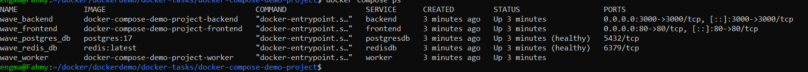
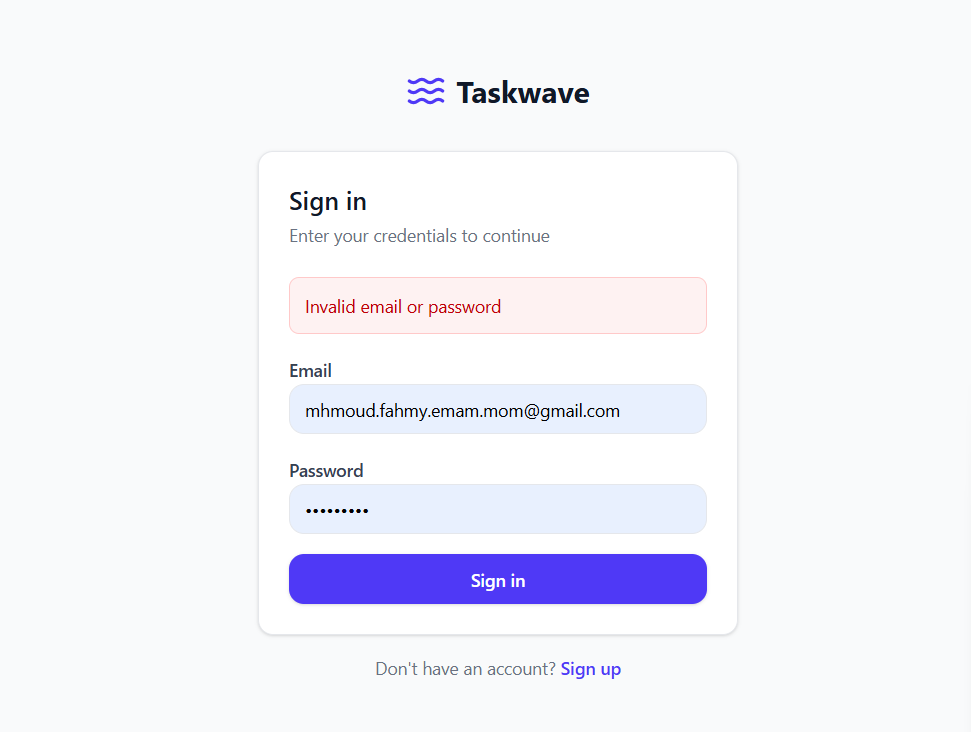
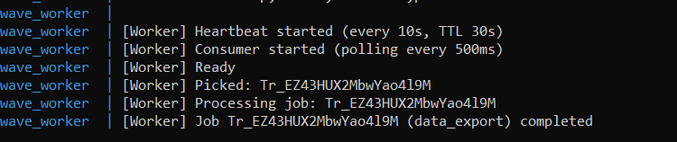
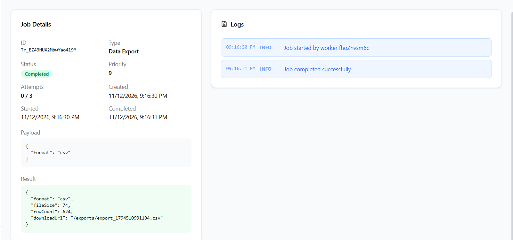
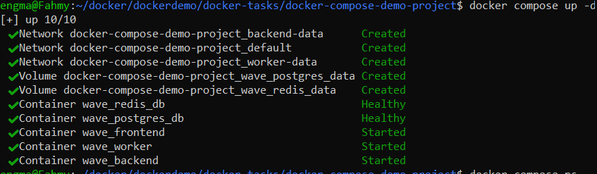

# TaskWave --- Docker Compose Assignment

## Diagram

                  User's browser
                    |
                    v
             +-------------+
             |  Frontend   |
             | React/Vite  |
             +-------------+
                    |
                    | HTTP API request
                    v
             +-------------+
             |     API     |
             | Node/Express|
             +-------------+
                |       |
        job data|       | enqueue job
                v       v
          +----------+ +----------+
          |PostgreSQL| |  Redis   |
          +----------+ +----------+
                ^          |
                |          | consume job
         update | status   v
                |    +-----------+
                |    |  Worker   |
                |____| Node.js   |
                     +-----------+
                           
## Networks

a network for back, postgres and redis

another for  worker, postgres and redis

no need for a back front network as all requests are handeld through the open ports  

## Screenshots
1. All Compose services running.

    

2. Frontend opened successfully and auth

    

3. A job submitted through the UI.

    

4. Worker logs showing job processing.
   
    

5. The job's final status/result.

    

6. Redis and PostgreSQL health/readiness checks.

    

## explanation 

1. Why the API and worker are separate services.

    1. the seperation provide a faster response from the api isolated from the background work latency 
    2. it gives a scalablity advantage as we could scale the worker without any need to sacle the api 

2. How the API and worker communicate through Redis.

    the api post the job to the queue without any need to tell the worker 
    the worker make a periodic check to see if there are jobs to consume without needing any signal from the api 
    and then give the status back through postgres
    
3. How containers resolve each other by Compose service name.
    docker compose netowrks provide a local dns to each network that resolve the container name to its needed ip 
    so if 2 or more containers are in the same network no need to set an ip for comunication 

4. How PostgreSQL data is persisted.
    with a named volume 

5. Why the frontend API URL must be reachable from the browser.
    
    the scripts in the frontend doesn't run inside its container it runs in a browser so it can't use the dns trick like the other containers talking to each other so if a request is send from the ui to the api it must know the actual ip and port.

6. The difference between docker compose down and docker compose down -v.

    compose down remove containers and networks but not there volumes and data
    compose down -v removes the volume and data also.

                       